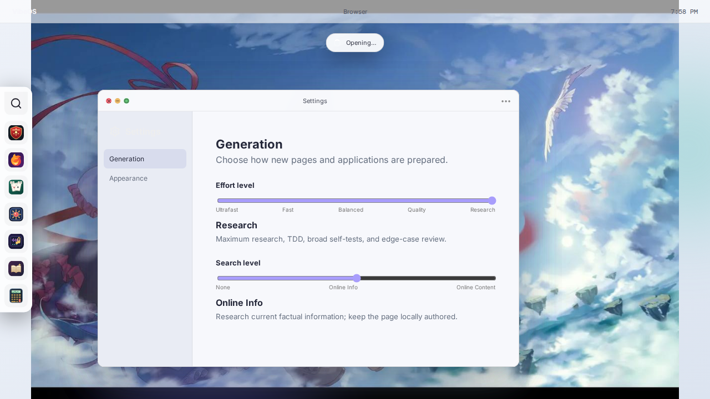

**English** | [简体中文](README.zh-CN.md)


# VibeOS

### A browser-hosted operating system that grows on demand

**VibeOS runs a desktop in a browser tab and writes the software it is missing: open an app, a page, or a child window of an app that does not exist yet, and a scoped Codex worker generates it — validated, published into `world/`, and resumed where your original action left off.**



*The desktop, launcher, settings and generated apps, all rendered in one browser tab — screenshots committed under [`docs/screenshots/`](docs/screenshots/).*

## Quick start

Requirements: Node.js 20+, npm, and a `codex` CLI/provider on `PATH` (override the binary with `CODEX_BIN`) for live generation. Without a provider you can still browse the apps committed under `world/apps/`.

```bash
npm install
npm run dev
```

`npm run dev` starts both workspaces. Open the Vite URL (default `http://localhost:5173`); the runtime listens on `ws://localhost:8787` and answers `/health` with `{"ok":true}`. Click any icon — desktop, launcher, and every app you open come from the world tree.

Verify without a provider:

```bash
npm test                                   # build + unit tests for the server runtime
npm run e2e --workspace @vibeos/web        # Playwright (Chromium) against a deterministic agent
```

The e2e run boots the server with `VIBEOS_AGENT_MODE=deterministic`, so no provider is called.

## What it can do now

- **A real desktop shell** — window lifecycle (focus, minimize, maximize, move, resize), dock, launcher, command palette, keyboard shortcuts, themes and display scale.
- **A durable world tree** — every app, site, game, editor, simulator and child page is a node under `world/` (`node.json`, entry HTML, `data/`, `children/`). The tree is the cache; missing descendants are generated on entry.
- **A lazy generation harness** — a versioned work order (original intent, acceptance criteria, context, settings, prior failures) runs in an isolated staged workspace, produces structured output, is validated, repaired within bounds, and published transactionally. Failed candidates are never published.
- **Containment and evidence** — generated frames run at an opaque origin behind a channel-bound bridge; storage is namespaced per node; job records keep transitions, events, validation, screenshots and repairs under the ignored `world/.jobs/`.
- **A capability bridge, not a script tag** — generated pages call `window.vibeOS` for navigation, state read/write, patch-based state updates with revisions, notifications, `ai.command` (scoped to an app, its descendants, or the whole world) and `process.run`.
- **An assistant with real context** — window screenshots, recent operations and node identity are handed to the agent, and the agent can ask structured or free-text questions back.
- **Thirty-nine world nodes shipped** — 3D model and CAD editors, MIDI and music studios, games (CS 1.6, DotA 2, Warcraft III, Minesweeper, FreeCell, Tetris…), browsers with child sites, phone and Android simulators, office and code editors.
- **Input and appearance** — a bundled Pinyin input method, light/dark/desert appearance modes, dock placement, UI and mono typefaces, five display scales, and model/reasoning/effort/search settings surfaced in the OS settings app.

## Architecture

Core owns only generic mechanisms; generated content owns all app-specific meaning. A feature belongs in core only when it cannot be expressed as replaceable world content through the public runtime interfaces — no app-name checks, no blessed commands.

```text
apps/            the runtime, split in two workspaces
  server/        Node HTTP + WebSocket server: runtime state, world loading,
                 artifact verification, generation harness, Codex adapter
  web/           React desktop shell (Vite): windows, dock, launcher, palette,
                 input method, window capture, Playwright specs
packages/shared/ intents, settings, snapshots, runtime events, bridge contracts
world/           the durable world tree — one directory per node, data, children
papers/          manuscript (main.tex), claims ledger (CLAIMS.md), bibliography
docs/            design, generation-harness contract, project status, screenshots
assets/          logo
vendor/hyperframes   git submodule: the skill library used by generated video apps
```

How the pieces talk: the browser sends intents over the WebSocket (`open_app`, `open_surface`, `move_window`, `activate_control`, `storage_write`, `ai.command`, …) and receives snapshots plus incremental window/surface/trace events. Generated pages never touch the server directly — they post bridge requests from a sandboxed frame, and the runtime validates and applies them. A cache miss turns into a scoped generation, whose published artifact is what the frame then loads.

Canonical documents: [`docs/vibeos-design.md`](docs/vibeos-design.md) (architecture and runtime flow), [`docs/generation-harness-plan.md`](docs/generation-harness-plan.md) (work-order contract and hardening backlog), and [`AGENTS.md`](AGENTS.md) (the core boundary rules any change must respect).

## How to develop

```bash
npm install                 # root workspace install (apps/*, packages/*)
npm run dev                 # server (tsx watch) + web (vite) together
npm test                    # server: tsc -b, then node --test on dist/*.test.js
npm run build               # tsc -b + vite build for every workspace
npm run e2e --workspace @vibeos/web   # Playwright, Chromium, deterministic agent
```

| Variable | Default | Effect |
| --- | --- | --- |
| `VIBEOS_PORT` | `8787` | server HTTP/WebSocket port |
| `VIBEOS_WORLD_ROOT` | `./world` | world tree root |
| `VIBEOS_STATE_FILE` | `world/.runtime-state.json` | persisted runtime snapshot |
| `VIBEOS_AGENT_MODE` | live | `deterministic` swaps the Codex adapter for a scripted one |
| `CODEX_BIN` | `codex` | provider binary used for generation |
| `VIBEOS_GENERATION_CONCURRENCY` | `2` | parallel generation workers |
| `VIBEOS_GENERATION_TIMEOUT_MS` | `900000` | per-generation timeout |

Visual changes require screenshot review; the repo keeps its UI evidence in `docs/screenshots/`.

## How to contribute

Issues and focused pull requests are welcome. Keep core generic, put app-specific meaning in `world/`, and ship tests plus before/after screenshots for visual changes. Read [`CONTRIBUTING.md`](CONTRIBUTING.md) for the checks a PR must pass and [`AGENTS.md`](AGENTS.md) before touching the runtime — agents are welcome to triage, investigate, test, document and implement accepted issues.

## Roadmap

**Implemented**

- Desktop shell, world-tree addressing, window and surface lifecycle, persistence, settings and themes.
- Generation harness: scoped work orders, isolated workers, structured handoff, validation, bounded repair, transactional publication, job evidence.
- Bridge transport with patch validation, revisions, subscriptions and refresh notifications.
- Deterministic unit and browser test paths, plus a claims ledger that maps each paper claim to source evidence.
- Thirty-nine committed world nodes and a screenshot set for them.

**Planned (deferred, not guaranteed)**

- OS/container resource and network limits for generated workers.
- Cancellation and restart recovery UI.
- Asset provenance and license handling for generated content.
- Disposable-repository repair, browser accessibility gates.
- Migration of the seeded system views.

The project is a closed experimental milestone: it reached its goal and no active development is planned unless its inputs or goals change ([`docs/project-status.md`](docs/project-status.md)). The future, if it is picked up again, is sharper generated 2D/3D software, automated visual and accessibility verification, a real recovery UX, provenance tracking, shareable world trees, collaboration, and explicit device bridges — aspirations today, not shipped behaviour.

## License

[AGPL-3.0-or-later](LICENSE). Third-party components and their licenses are listed in [`THIRD_PARTY_NOTICES.md`](THIRD_PARTY_NOTICES.md) — notably the MIT-licensed `naive-pinyin` IME engine and its CC-BY-4.0/MIT dictionaries.
